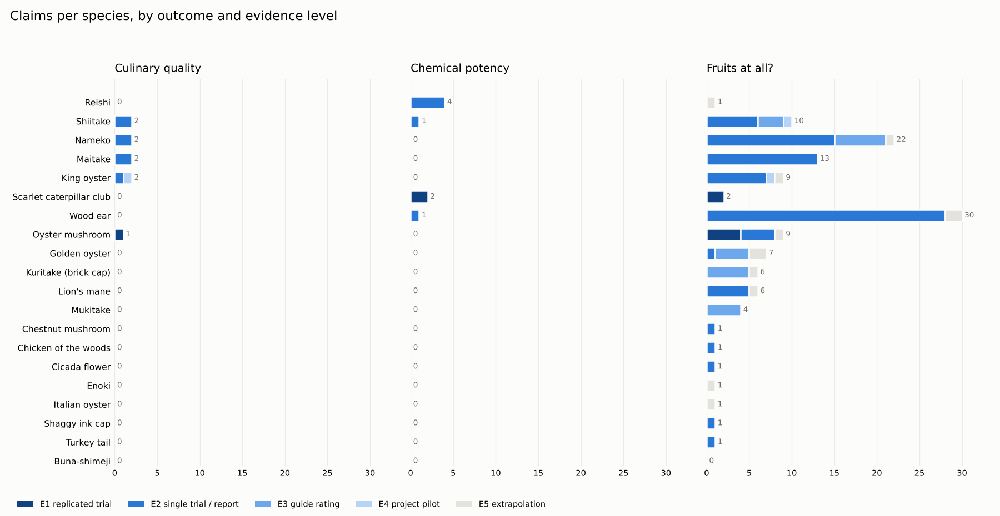

# Which wood for which mushroom? An evidence-graded answer, judged on taste and potency

**Open research from a small log-culture mushroom farm in the Tanzawa–Oyama foothills, Kanagawa, Japan.**

Growers choose a log species for each mushroom by tradition, supplier advice or a guide's ◎. This repository records *why* each choice is believed, grades how good that reason is, and sets out trials for the choices that have no good reason yet.

The farm sells on **culinary quality** and **chemical potency** (β-glucan, ergothioneine, triterpenes, cordycepin and so on), not on volume. So those are the outcomes here. Yield is not measured; published production data is used only to ask whether a species fruits on a wood at all.

* **153 claims** about 20 cultivated species on 56 substrates, from 42 sources, each with a DOI or URL
* **Every claim graded**, from E1 (replicated trial with statistics) to E5 (extrapolation, never presented as a finding), and **classed** as culinary, potency or fruiting, each graded separately
* **21 sources re-read against the originals**, and [12 corrections](docs/corrections.md) to the farm's own earlier reports
* **An audit of the farm's planting plan** for taste, potency and fruiting
* **6 pre-registered trial protocols** with blind tasting panels, lab assays, power analysis, randomisation and data templates
* One command rebuilds every table and figure from the data. CI checks that nothing drifts.


*Colour shows the outcome of the best available evidence, and the cell text shows its level. Dashed cells with **?** have only an extrapolation, and blank cells have nothing. Full matrices across all substrates: [culinary](results/figures/matrix_all_culinary.png), [potency](results/figures/matrix_all_potency.png), [fruiting](results/figures/matrix_all_fruiting.png).*

## What the evidence says

**The headline: nobody has compared taste or potency between named log woods.** For the 20 species × 11 woods this farm can get, only **1 of 220 cells** has any culinary evidence (the farm's own carrot eringi pilot) and only **1 of 220** has any potency evidence (reishi from ume). Fruiting evidence covers 27 of 220 ([`results/gaps.md`](results/gaps.md)). Every wood choice the farm makes for taste is, so far, untested.

**What *is* known about quality and substrate** ([`docs/quality-methods.md`](docs/quality-methods.md) §6):

* **Logs beat sawdust beds for maitake, nameko and reishi.** Log maitake had more umami and sweet amino acids and more 5′-GMP. Log-grown nameko soup was preferred on taste (P < 0.001) and aroma. Log reishi had about 1.2× the triterpenoids, more lucidenic acids and higher antioxidant capacity, with equal polysaccharides. (E2)
* **Shiitake is mixed.** Sawdust gave more free amino acids, including bitter ones; logs gave slightly more 5′-GMP. (E2)
* **Substrate species matters for eringi.** Willow sawdust gave the best taste and texture against birch and corncob. (E2)
* **Cordyceps has a form–potency trade-off.** On rhinoceros beetle larvae it had about 34× the cordycepin of silkworm pupae, but silkworm gave the best-formed fruit bodies. (E1, one study, 3 replicates) → [P06](protocols/P06-cordyceps-host-potency.md)
* **Reishi from ume had the strongest bioactivity** of the hosts tested, in sterile sawdust culture. (E2) → [P05](protocols/P05-reishi-ume-potency.md)

**The farm's own plan** ([`results/plan_audit.md`](results/plan_audit.md)), 42 species–wood pairings:

| | Culinary | Potency | Fruits at all? |
|---|---|---|---|
| Supported | 0 | 1 (reishi on ume) | 11 |
| Contradicted | 0 | 1 (Cordyceps on silkworm: lowest cordycepin) | 1 (kikurage on konara) |
| Mixed evidence | 0 | 0 | 1 (kikurage on cherry) |
| Farm pilot only | 1 (eringi on carrot) | 0 | 1 |
| Hypothesis or no evidence | 41 | 40 | 28 |

* **Kikurage on konara is contradicted for fruiting.** Kunugi gave almost nothing in every Saga batch, and Aomori ranked konara last of three woods, while akamegashiwa (アカメガシワ) and dogwood (ミズキ) were among the best. (E2) → [P03](protocols/P03-kikurage-wood-trial.md)
* **Hornbeam (シデ類) is rated best (◎) for nameko and kuritake** and good for shiitake. The farm already has access to it. (E3)
* **22 pairings have no evidence of any kind, 12 of them in use now.** These include enoki, hiratake, Italian oyster and golden oyster on cherry, and turkey tail, chestnut mushroom and chicken of the woods on both konara and cherry. → [P04](protocols/P04-hackberry-zelkova-enoki-golden-oyster.md)
* **Kikurage results come from *Auricularia cornea*** (アラゲキクラゲ). Whether they hold for *A. heimuer* is unknown.



## Field result: eringi on fresh, buried carrot ([OBS-01](docs/observations/OBS-01.md))


Pieces of a commercial eringi kit, pushed into **fresh, unsterilised carrots** skinned, and buried in a pot of straw and leaf litter, pinned by 2026-11-10 and gave a full tray by 2026-11-19. We found no report of eringi on fresh carrot (only dried, sterilised carrot as an additive), and eringi failed on all six log woods in Aichi. The caps are broad and flat with **dark radial "zebra" streaks**, nothing like indoor eringi, and in an informal tasting in nabe, **all four blind tasters found them meatier** than supermarket eringi (4/4, p = 0.06).

That is one bed, no controls, and a tasting against supermarket eringi of a different strain, freshness and growing system, so it is graded E4: a hypothesis, not a finding. [P02](protocols/P02-eringi-fresh-carrot.md) tests it properly: a blind panel and umami chemistry (glutamate, 5′-GMP, EUC) against kit-only plots and commercial eringi of the same strain, with a shade-and-humidity sub-study to find out what causes the streaks.

**Paper:** [King oyster fruiting outdoors from fresh, unsterilised buried carrot (preprint, PDF)](paper/eringi-fresh-carrot.pdf)

## Trials (pre-registered)

| | Question | Primary outcomes | Status |
|---|---|---|---|
| [P01](protocols/P01-shiitake-kit-vs-dowel.md) | Does kit-block inoculum colonise raw konara faster than dowel spawn, **without costing taste**? | Days to colonisation; blind liking (non-inferiority) | **Planned, spring 2027** |
| [P02](protocols/P02-eringi-fresh-carrot.md) | Is carrot-grown eringi really meatier? | Blind umami/meaty rating; EUC | Proposed |
| [P03](protocols/P03-kikurage-wood-trial.md) | Does kikurage on sugi or Japanese cinnamon keep its crunch? | Blind firmness; rehydration and TPA; polysaccharides | Proposed |
| [P04](protocols/P04-hackberry-zelkova-enoki-golden-oyster.md) | Do hackberry or zelkova give better enoki and golden oyster than cherry? | Blind umami / liking; ergothioneine | Proposed |
| [P05](protocols/P05-reishi-ume-potency.md) | Does the ume potency advantage hold on raw, buried logs? | Total triterpenes | Proposed |
| [P06](protocols/P06-cordyceps-host-potency.md) | Cordycepin on wild moth pupae vs silkworm vs beetle larvae | Cordycepin; fruit-body form | Proposed |

Every protocol uses the same quality methods ([`docs/quality-methods.md`](docs/quality-methods.md)): same-flush, same-stage sampling with the log or plot as the unit; a coded, Williams-balanced blind panel on 0–100 line scales; penetrometer or TPA texture and a fixed shelf-life score; umami chemistry by HPLC with Yamaguchi's equivalent umami concentration; and the key potency compounds for each species, reported per gram of dry weight. Each states hypotheses, controls, blocking, sample size with power ([`results/power.md`](results/power.md)), a seeded randomisation ([`analysis/randomise.py`](analysis/randomise.py)), blinding, an analysis plan fixed in advance and a deviation log. A protocol is frozen with a `prereg/Pxx` git tag and an OSF registration before the first unit is inoculated. Results are published whichever way they go.

## Evidence levels

| | | |
|---|---|---|
| **E1** | Replicated trial | Peer-reviewed, replicated, with inferential statistics, and the design has been checked |
| **E2** | Single trial or report | Prefectural trials, unreplicated studies, published host records |
| **E3** | Guide rating | Expert ◎/○ ratings with no data shown |
| **E4** | Farm pilot | This farm's own unreplicated observations, such as OBS-01 |
| **E5** | Extrapolation | Reasoning from related trees or fungi. Each row states why; it is a hypothesis to test |

Culinary, potency and fruiting claims are graded separately. A cell takes its grade from its **best** evidence level only. Within that level the outcome is the median, rounded *down*, and the cell is flagged when claims disagree. Plan grades are never evidence. The full rules are in [`docs/evidence-grading.md`](docs/evidence-grading.md).

## Repository layout

```
data/                 the dataset (source of truth)
  evidence.csv        one row per claim: species, substrate, class, dimension, level, outcome, value, source, locator
  sources.csv         citations, DOI/URL, and whether each was re-read against the original
  species.csv         20 species with current names and taxon caveats
  substrates.csv      56 substrates with family, wood anatomy, and whether the farm can get them
  plan_assignments.csv  the farm's current planting plan, to be audited
datapackage.json      Frictionless Data schema: types, enums, keys, foreign keys
analysis/
  build.py            validate + rebuild matrices (per class), plan audit, gaps and figures
  power.py            simulation-based power for every protocol (numpy only)
  randomise.py        blocked, seeded allocation with blind codes
protocols/            pre-registered trial protocols P01–P06
templates/            CSV templates: logs, beds, colonisation, harvests, samples, sensory,
                      assays, texture, shelf life, events, environment
results/              generated: do not edit by hand
docs/                 grading rules, quality methods, metrics, corrections, field observations
tests/                pytest checks on the data and the grading rules
```

## Use it

```bash
pip install -r requirements.txt
pytest -q                      # validate the data and the grading rules
python analysis/build.py       # rebuild results/ and the figures
python analysis/power.py       # rebuild results/power.md
```

**Adding evidence.** Add a row to `data/evidence.csv`, add its source to `data/sources.csv`, and run `pytest`. The validator rejects a wrong level for the study type, an E1 claim whose design has not been checked, an extrapolation with no stated reasoning, and any source with no link. Corrections and new sources are welcome as issues or pull requests, especially Japanese prefectural reports.

## Licence

Data, protocols, documents and figures: **[CC BY-NC-SA 4.0](LICENSE-DATA.md)**. Reuse and adapt them for non-commercial purposes, with credit, under the same licence. For commercial use, ask. Code: **[MIT](LICENSE)**. The farm's name and brand are not licensed. See [NOTICE.md](NOTICE.md) and [CITATION.cff](CITATION.cff).
