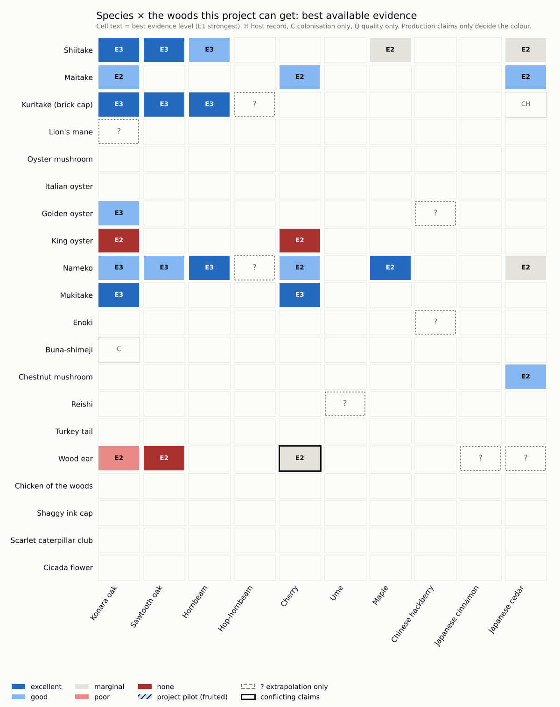

# Which wood for which mushroom? An evidence-graded answer

**Open research from a small log-culture mushroom farm in the Tanzawa–Oyama foothills, Kanagawa, Japan.**

Growers choose a log species for each mushroom by tradition, supplier advice or a guide's ◎. This repository records *why* each choice is believed, grades how good that reason is, and sets out trials for the choices that have no good reason yet.

* **135 claims** about 20 cultivated species on 54 substrates, from 32 sources, each with a DOI or URL
* **Every claim graded**, from E1 (replicated trial with statistics) to E5 (extrapolation, which is never presented as a finding)
* **11 key sources re-read against the originals**, and [12 corrections](docs/corrections.md) to the project's own earlier reports
* **An audit of the farm's own planting plan** against that evidence
* **5 pre-registered trial protocols**, with power analysis, randomisation, blinding and data templates
* One command rebuilds every table and figure from the data. CI checks that nothing drifts.



*Colour shows the outcome of the best available evidence, and the cell text shows its level. Dashed cells with **?** have only an extrapolation, and blank cells have nothing. Full matrix across all substrates: [`results/figures/matrix_all.png`](results/figures/matrix_all.png).*

## What the evidence says

**About the farm's own plan** ([`results/plan_audit.md`](results/plan_audit.md)). Of the 24 species–wood pairings in use now, **6 are supported** by a trial or a prefectural rating:

* shiitake, kuritake and maitake on konara
* nameko and mukitake on cherry
* shaggy ink cap on a cased compost mix

The rest are not:

* **Kikurage on konara is contradicted.** Kunugi gave 0 to 0.9 kg/m³ in all four Saga batches and シラカシ gave nothing, while the best akamegashiwa (アカメガシワ) and dogwood (ミズキ) batches gave 32 to 50 kg/m³. Aomori ranked konara last of three woods. (E2)
* **Reishi on ume rests on bioactivity, not yield.** The ume paper measured enzyme and blood-pressure assays, not harvest. Ume as a production wood is untested. → [P05](protocols/P05-reishi-ume-yield.md)
* **Ten pairings have no evidence at all.** These are enoki, hiratake, Italian oyster and golden oyster on cherry, plus turkey tail, chicken of the woods and chestnut mushroom on both konara and cherry. Lion's mane on konara rests only on a Korean trial of an unnamed oak. They may well work, but nobody has measured it.

**Findings worth acting on:**

* **Hornbeam (シデ類) is rated best (◎) for nameko and kuritake** and good for shiitake. The farm already has access to it. (E3)
* **Maitake does not need oak.** Alder beat konara over six years. Sugi gave 78 to 88% of konara's yield for two strains, while a third gave nothing. Strain choice changed yield on the same konara by about 48%. (E2)
* **Kikurage results come from *Auricularia cornea*** (アラゲキクラゲ). Whether they hold for *A. heimuer* is unknown.
* **Eringi failed on all six log woods in Aichi** (contamination). That makes the farm's fresh-carrot method, which fruited on 2026-11-11, more interesting, but it has not yet been replicated. → [P02](protocols/P02-eringi-fresh-carrot.md)

**Where the gaps are** ([`results/gaps.md`](results/gaps.md)). For the 16 wood-decay species × 10 woods the farm can get, **136 of 160 cells have no production evidence**.


## Trials (pre-registered)

| | Question | Status |
|---|---|---|
| [P01](protocols/P01-shiitake-kit-vs-dowel.md) | Does kit-block inoculum colonise raw konara faster than dowel spawn of the same strain? 60 logs from 10 source trees, blinded photo scoring | **Planned, spring 2027** |
| [P02](protocols/P02-eringi-fresh-carrot.md) | Does fresh, unsterilised carrot add eringi yield beyond the kit inoculum itself? | Proposed |
| [P03](protocols/P03-kikurage-wood-trial.md) | Kikurage on sugi and Japanese cinnamon vs the akamegashiwa benchmark | Proposed |
| [P04](protocols/P04-hackberry-zelkova-enoki-golden-oyster.md) | Enoki and golden oyster on hackberry and zelkova vs cherry | Proposed |
| [P05](protocols/P05-reishi-ume-yield.md) | Reishi yield on ume vs konara vs cherry | Proposed |

Each protocol states its hypotheses, controls, blocking, sample size with power ([`results/power.md`](results/power.md)), a seeded randomisation ([`analysis/randomise.py`](analysis/randomise.py)), blinding, outcome definitions ([`docs/metrics.md`](docs/metrics.md)), an analysis plan fixed in advance, and a deviation log. A protocol is frozen with a `prereg/Pxx-v1` git tag and an OSF registration before the first unit is inoculated. Results are published whichever way they go.

## Evidence levels

| | | |
|---|---|---|
| **E1** | Replicated trial | Peer-reviewed, replicated, with inferential statistics, and the design has been checked |
| **E2** | Single trial or report | Prefectural trials, unreplicated studies, published host records |
| **E3** | Guide rating | Expert ◎/○ ratings with no data shown |
| **E4** | Farm pilot | This farm's own unreplicated observations |
| **E5** | Extrapolation | Reasoning from related trees or fungi. Each row states why; it is a hypothesis to test |

A cell takes its grade from its **best** evidence level only. Within that level the outcome is the median, rounded *down*, and the cell is flagged when claims disagree. Plan grades are never evidence. The full rules are in [`docs/evidence-grading.md`](docs/evidence-grading.md).

## Repository layout

```
data/                 the dataset (source of truth)
  evidence.csv        one row per claim: species, substrate, level, outcome, value, source, locator
  sources.csv         citations, DOI/URL, and whether each was re-read against the original
  species.csv         20 species with current names and taxon caveats
  substrates.csv      54 substrates with family, wood anatomy, and whether the farm can get them
  plan_assignments.csv  the farm's current planting plan, to be audited
datapackage.json      Frictionless Data schema: types, enums, keys, foreign keys
analysis/
  build.py            validate + rebuild matrix, plan audit, gaps and figures
  power.py            simulation-based power for every protocol (numpy only)
  randomise.py        blocked, seeded allocation with blind codes
protocols/            pre-registered trial protocols P01–P05
templates/            CSV templates for logs, colonisation scores, harvests, beds, events, environment
results/              generated: do not edit by hand
docs/                 grading rules, metric definitions, corrections
tests/                pytest checks on the data and the grading rules
```

## Use it

```bash
pip install -r requirements.txt
pytest -q                      # validate the data and the grading rules
python analysis/build.py       # rebuild results/ and the figures
python analysis/power.py       # rebuild results/power.md
```

**Adding evidence.** Add a row to `data/evidence.csv`, add its source to `data/sources.csv`, and run `pytest`. The validator rejects a wrong level for the study type, an E1 claim whose design has not been checked, an extrapolation with no stated reasoning, and any source with no link. Corrections and new sources are welcome as issues or pull requests, especially Japanese prefectural reports.

## Licence

Data, protocols, documents and figures: **[CC BY-NC-SA 4.0](LICENSE-DATA.md)**. Reuse and adapt them for non-commercial purposes, with credit, under the same licence. For commercial use, ask. Code: **[MIT](LICENSE)**. The farm's name and brand are not licensed. See [NOTICE.md](NOTICE.md) and [CITATION.cff](CITATION.cff).
