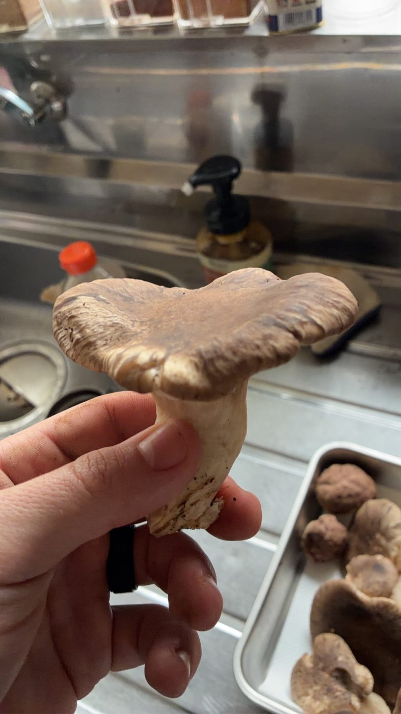

# OBS-01: King oyster (eringi) on fresh, unsterilised buried carrots

**Evidence level:** E4, a project pilot. It is unreplicated and unblinded, and it is a single bed. Evidence rows: EV0121 (fruiting) and EV0153 (tasting note).

## Method, as done

* Fresh carrots were pulled, skinned (peeled), had leaves and stems removed, were inoculated with pieces of a commercial eringi kit block, and were buried in a **pot filled with straw and leaf litter**.
* They were **not dried or sterilised.** The only prior use of carrot the project knows of used dried, sterilised carrot as an additive.
* A casing of straw plus leaf litter was laid over the bed to keep CO₂ high around the developing pins.
* No controls were run: no kit pieces without carrot, and no carrot without inoculum.

## What happened

| Date | Observation |
|---|---|
| 2026-11-11 | White primordia and young pins came up through the casing |
| by 2026-11-19 | Mature fruit bodies were harvested, filling a full tray |

## Morphology (from the photos)

* **Cap:** wide (several cm across), flat to slightly depressed, mid-brown, with a wavy, lobed margin. Indoor commercial eringi has a small cap on a thick stem; these are the reverse.
* **Streaking:** dark brown radial streaks and stripes over the outer half of the cap give a "zebra" look. Near the centre the cap is evenly brown.
* **Gills:** cream, crowded, and running far down the stem (decurrent), as expected for *Pleurotus eryngii*.
* **Stem:** short to medium, often curved, cream, tapering to a rooting base set in the casing and carrot debris.

**Why the streaks? Three hypotheses, none tested yet:**

1. **Light.** Outdoor light raises cap pigmentation, and the pigment is laid down unevenly along radial fibrils.
2. **Drying.** Wind and drying crack or tighten the cap cuticle, exposing darker tissue in radial lines.
3. **Ordinary wild-type caps.** Low CO₂ and full light produce the broad-capped form, and fine radial patterning on such caps is normal.

Protocol P02 tests 1 and 2 with a shade and humidity cover (§P02.6). Some of the round, rough-capped mushrooms in the tray photo may be shiitake from the logs; that has not been confirmed.

## Taste (informal 5-person comparison)

> "The taste of them is more meaty." (J. A. Wittcop, the grower, 2026-11-19)

Five people tasted the carrot eringi against **store-bought Japanese supermarket eringi** (corrected 2026-11-19: first recorded as one taster comparing with memory). Both were cooked in **nabe** (hot pot). **Four of the five were blind** to which sample was which, and **all four judged the carrot eringi meatier** (4/4; one-sided exact binomial p = 0.0625). The fifth, the grower, knew. The two mushrooms look very different, so tasters could tell them apart without knowing the source. Who served, and whether they knew, was not recorded. Not recorded: the cooking method, how many of the five agreed, and any scores.

The comparison differs in much more than carrot: **strain** (supermarket strain unknown), **freshness** (hours vs days from harvest), **maturity** (broad mature caps vs young small caps) and **growing system** (outdoor casing vs indoor sterile bottle or bag). It is **a hypothesis, not a finding**. Protocol P02 tests it blind, against kit-only eringi and against commercial eringi of the same strain, and chemically, through glutamate, 5′-GMP and EUC.

## Method change from 2026-11-19: spore slurry, then liquid culture

As of 2026-11-19 the grower inoculates carrots differently. **Watering globes** push a **spore slurry** into the buried carrots. The aim is for the eringi population to **adapt to carrot**. Later the inoculum will be a **liquid culture**.

This is a real change in what is being grown, not only in how it is delivered:

* **Kit pieces** (the 2026-11 pilot) carry one strain, a single clone of the kit's dikaryon.
* **A spore slurry** carries many genetically different spores. *P. eryngii* is heterothallic, so spores must germinate and mate in the carrot to give new dikaryons. Each fruiting patch may be a **new genotype**, not the kit strain. Selection can only act on that variation over repeated rounds, by choosing which fruit bodies supply the next slurry or culture.
* **A liquid culture** fixes one genotype again. If it is started from tissue of the best carrot-grown fruit body (a tissue clone), it captures whatever the slurry rounds selected.

What follows for interpretation:

* A taste or morphology difference from slurry-grown eringi may come from **genotype**, not from carrot. Whether slurry beds are compared with kit beds or with commercial eringi, that confound has to be named.
* "Adapted to carrot" is a hypothesis. It can be tested by growing the **carrot-selected clone** and the **original kit strain** side by side on carrot and comparing colonisation, fruiting, taste and potency. That comparison is now in P02 (§6b).
* **Record for every bed:** inoculum type (kit / slurry / LC), the source fruit body for each slurry or culture (photo, date, bed), spore print or slurry density if measured, and the generation number (kit = G0, first slurry from carrot-grown caps = G1, …). Use `events.csv`, and keep one spore print or tissue sample from each source fruit body.

## What it does and does not show

* **It shows** that eringi can complete fruiting outdoors from kit pieces buried with fresh carrot under a straw and leaf casing. That matters, because Aichi's attempt to grow eringi on six kinds of log gave no fruit (EV0032–EV0037).
* **It does not show** that the carrot was the substrate. The kit pieces could have fruited alone. Nor does it show that the taste differs, or why the caps are streaked.
