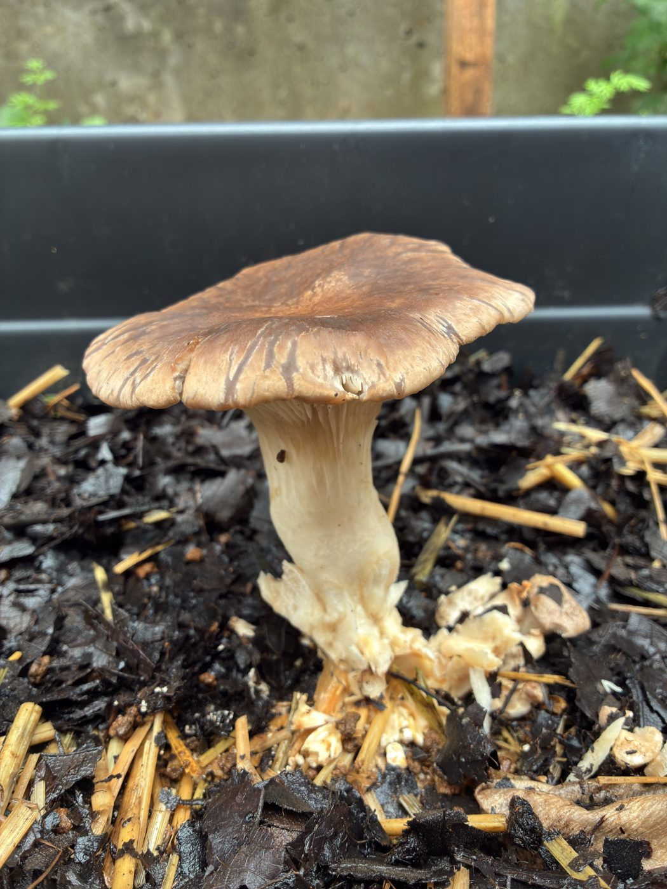
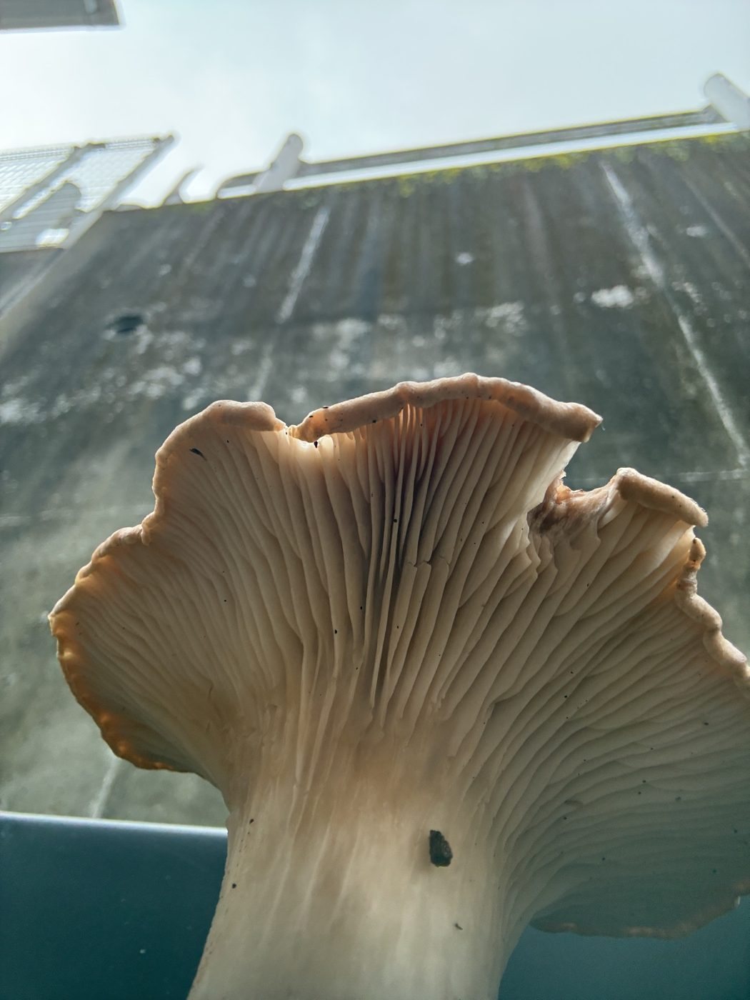
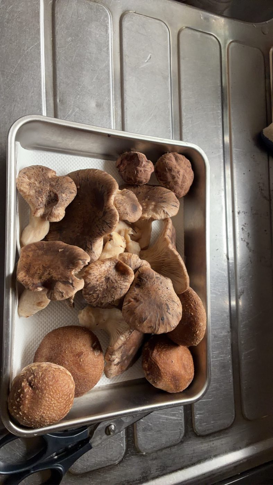

# OBS-01: King oyster (eringi) on fresh, unsterilised buried carrots

**Evidence level:** E4, a project pilot. It is unreplicated and unblinded, and it is a single bed. Evidence rows: EV0121 (fruiting) and EV0153 (tasting note).

## Method, as done

* Fresh carrots were pulled, inoculated with pieces of a commercial eringi kit block, and buried again in a bed under the ULCANS shade net.
* They were **not dried or sterilised.** The only prior use of carrot the project knows of used dried, sterilised carrot as an additive.
* A casing of straw plus leaf litter was laid over the bed to keep CO₂ high around the developing pins.
* No controls were run: no kit pieces without carrot, and no carrot without inoculum.

## What happened

| Date | Observation |
|---|---|
| 2026-11-11 | White primordia and young pins came up through the casing |
| by 2026-11-19 | Mature fruit bodies were harvested, filling a full tray |

## Morphology (from the photos)

* **Cap:** wide (several cm across), flat to slightly depressed, mid-brown, with a wavy, lobed margin. Indoor commercial eringi has a small cap on a thick stem; these are the reverse.
* **Streaking:** dark brown radial streaks and stripes over the outer half of the cap give a "zebra" look. Near the centre the cap is evenly brown.
* **Gills:** cream, crowded, and running far down the stem (decurrent), as expected for *Pleurotus eryngii*.
* **Stem:** short to medium, often curved, cream, tapering to a rooting base set in the casing and carrot debris.

**Why the streaks? Three hypotheses, none tested yet:**

1. **Light.** Outdoor light raises cap pigmentation, and the pigment is laid down unevenly along radial fibrils.
2. **Drying.** Wind and drying crack or tighten the cap cuticle, exposing darker tissue in radial lines.
3. **Ordinary wild-type caps.** Low CO₂ and full light produce the broad-capped form, and fine radial patterning on such caps is normal.

Protocol P02 tests 1 and 2 with a shade and humidity cover (§P02.6). Some of the round, rough-capped mushrooms in the tray photo may be shiitake from the logs; that has not been confirmed.

## Taste (grower's note, unblinded)

> "The taste of them is more meaty." (Hakam, 2026-11-19)

This is one taster, comparing against memory, who knew which mushroom was which. It is **a hypothesis, not a finding**. Protocol P02 tests it blind, against eringi from kit pieces alone and against commercial eringi of the same strain. It also tests it chemically, through glutamate, 5′-GMP and EUC.

## What it does and does not show

* **It shows** that eringi can complete fruiting outdoors from kit pieces buried with fresh carrot under a straw and leaf casing. That matters, because Aichi's attempt to grow eringi on six kinds of log gave no fruit (EV0032–EV0037).
* **It does not show** that the carrot was the substrate. The kit pieces could have fruited alone. Nor does it show that the taste differs, or why the caps are streaked.
